  
  <h1>Alquileres Deportivos - Ayuntamiento de Tarancón</h1>
  
<strong>Plataforma integral para la reserva y gestión de instalaciones deportivas municipales.</strong>

---

## 📖 ¿Qué es este proyecto?

Esta página web es el portal oficial (en fase de desarrollo y simulada) del **Ayuntamiento de Tarancón** para la reserva de pistas deportivas, específicamente enfocada en las instalaciones de **Tenis** y **Pádel** (cubiertas y descubiertas).

El sistema está diseñado con una doble finalidad:
1. **Cara al Público (Ciudadanos):** Una interfaz rápida, accesible y moderna que permite visualizar la disponibilidad de las pistas deportivas 30 días vista, y proceder al "pago" (actualmente una simulación visual con checkout) para bloquear la pista.
2. **Cara Interna (Administración):** Un portal privado para funcionarios y concejalía de deportes que les permite bloquear y desbloquear pistas de manera gratuita para mantenimiento, eventos oficiales o escuelas deportivas, sincronizándose en tiempo real con la vista de los ciudadanos.

---

## 🚀 Estado Actual y Qué estamos haciendo ahora

Venimos de una primera fase estática usando únicamente HTML, CSS y LocalStorage, y **hace muy poco dimos nuestro mayor salto arquitectónico:**

- **Modularización:** Hemos transformado nuestras vistas en componentes dinámicos de PHP (extrayendo el `header` y el `footer`) para no duplicar código y mejorar el mantenimiento drásticamente.
- **Base de Datos Dinámica:** Hemos implementado MySQL (vía PDO) para registrar realmente si una franja horaria está ocupada.
- **Panel Administrativo `v1.2`:** Recientemente concluimos la capacidad del Ayuntamiento no solo de *bloquear* pistas para el público, sino también de *desbloquearlas* en caso de cancelación del evento administrativo.
- **Reservas Reales y Códigos QR `v1.3`:** Generación automática de códigos alfanuméricos y QR incrustados en correos electrónicos mediante SMTP, creando registros auténticos en la BD.
- **Validación de Formularios `v1.4`:** Estrictas validaciones frontend en tiempo real (DNI con mayúsculas, formatos exactos de teléfono) para garantizar la integridad de los datos de reserva.
- **Limpieza de Código y Assets:** Hemos organizado todo en carpetas específicas (`/html`, `/css`, `/js`, `/api`, `/admin`, `/docs`).

---

## 💡 Ideas para Futuras Mejoras (Roadmap)

Nuestro propósito es seguir profesionalizando la plataforma. Estas son las ideas principales que tenemos apuntadas para el futuro:

1. **Gestión Real de Usuarios Ciudadanos:** Sustituir la "reserva libre" por un sistema donde el ciudadano deba iniciar sesión (crear una cuenta, recuperar contraseña) para tener un historial de sus reservas pasadas y futuras.
2. **Integración de Pasarela de Pago Real:** Conectar el *Checkout* con plataformas como Stripe o Redsys para el cobro real de las tasas municipales, incluyendo el cálculo dinámico del "suplemento de luz".
3. **Roles Avanzados en Administración:** Actualmente todos interactúan como administrador. En el futuro, introduciremos el rol explícito de `concejal` con capacidades únicas (ej. reportes financieros, estadísticas de uso de pistas).
4. **Panel de Usuario Ciudadano:** Un "Mi Perfil" donde el taranconero pueda ver qué pistas tiene reservadas e incluso cancelarlas (según política de devoluciones).

---

## 🛠️ Stack Tecnológico

- **Frontend:** HTML5 semántico, CSS3 Puro (con utilidades modernas como flexbox/grid), JavaScript Vanilla.
- **Backend:** PHP 8+ (sin frameworks pesados, uso de `PDO` para consultas seguras).
- **Base de Datos:** MySQL.
- **Metodología:** Refracción por componentes del lado del servidor (SSR con `include` de PHP) para maximizar velocidad y SEO.

---

## 📝 Documentación Adicional

- [Guía de Instalación y Uso (INSTALL.md)](docs/INSTALL.md)
- [Historial de Cambios (CHANGELOG.md)](docs/CHANGELOG.md)

---
*Desarrollado con dedicación para los ciudadanos de Tarancón.*
